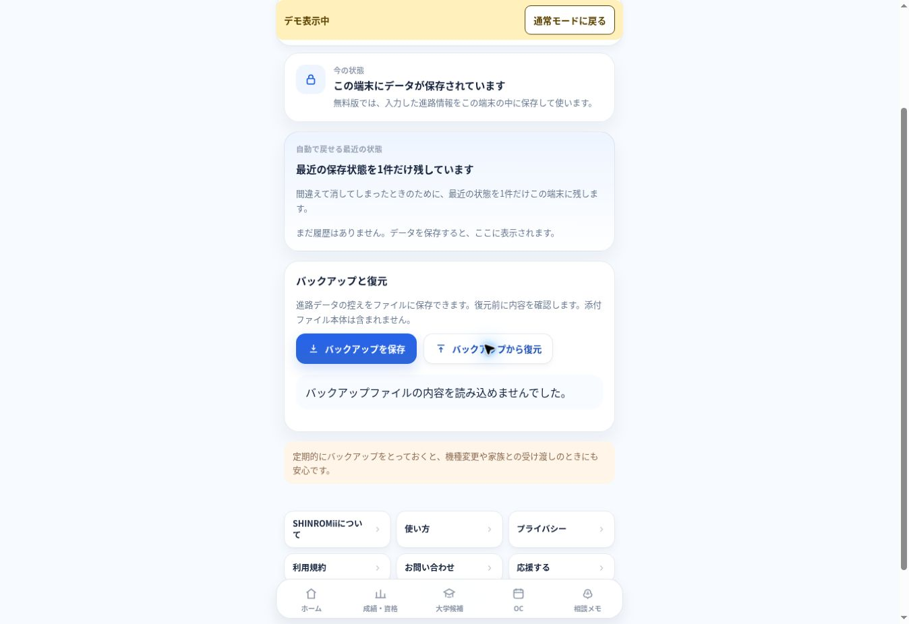

# Ver.1.06 security remediation

Base: `3f6a5a5d038465cf25c504ebd23bb96780bab2ac` (Ver.1.05).
Feature branch only. Main merge and Production release require owner approval.
No secrets, deployment protection settings, paid services, or stored notebook schema changed.

| Audit finding | Remediation |
| --- | --- |
| S1 dependencies | Next 16.4.6 pinned; lockfile includes Sharp 0.35.5 and source-map-js 1.2.2. npm audit: zero known advisories at validation time. |
| S2 backup | Validate record fields, bounded JSON, versions, date, duplicate IDs and attachment ownership before normalization/write. Reject the whole invalid import; never drop individual records to make it pass. Retain legacy optional fields, old score arrays, null/out-of-range grades and existing reference-grade exclusion behavior. |
| S3 attachments | Match extension, MIME and signature; accept empty/generic MIME only with a matching signature; repeat validation before every object URL. Metadata never overrides the blob's trusted MIME. HTML/SVG not supported. IndexedDB writes resolve only on transaction commit; abort is a failure. |
| S4 PWA cache | Explicit public shell/assets allowlist. Admin/API/query/RSC/authorization/range excluded. Respect no-store/private and remove old app caches upon activation. Notebook localStorage/IndexedDB never deleted. Public HTML revalidates; offline copies contain only the static public shell. |
| S5 feedback | Remove the separate Resend relay with instance-local limiting. Feedback now links to the existing CONTACT HUB contact form with its shared DB-backed limits and replay handling. Legacy API POST returns 410 without sending; GET reports unavailable. No new rate-limit infrastructure/secrets. |
| S6 admin/headers | Replace URL-key authorization with same-origin bounded POST form and existing signed, expiring HttpOnly/Secure cookie. Strip legacy URL keys before page rendering. Restrict redirects. Add CSP, frame denial, nosniff, no-referrer, Permissions-Policy and private/no-store admin/API responses. |

Additional: HTTP(S)-only navigation for stored school/event links, invalid link input rejection, autosave restore failure handling, CONTACT HUB privacy description, visible version 1.06.

## Reviewable behavior changes

- Feedback uses `/contact`; nickname, reply email, subject and message are required. It no longer sends anonymous feedback via the former modal. Notebook records are never attached.
- Admin entry is `/admin/access`; the existing key is typed into a password field. Old `?adminKey=...` bookmarks no longer authorize. Secret values were not read or rotated. This code-level auth-entry change is included in the proposal for owner release approval.
- The security SW update activates promptly, removing old cache entries but not forcing a page reload or touching unsaved form state/storage. An open old page must be reloaded to use the new application code.
- CSP allows inline framework scripts/styles to preserve static Next app shells. It forbids inline event handlers and eval in Production, but is not a nonce-based strict CSP. Signature checks enforce safe file types; they are not a malware scanner.
- Historical bad URL strings remain stored as text and are inert in links. A user can correct them explicitly. Malformed backups are rejected without replacement.

## Validation

Use only synthetic/demo data:

```sh
npm ci
npm test
npm run build
npm run typecheck
npm run test:http
npm audit
```

The pure regression suite includes the nine existing scenarios (feedback updated for the unified flow) and four new security suites. It covers backup corruption/legacy compatibility, normal/demo isolation, reference averages, attachment MIME/signatures/IDB abort, SW cache boundaries, admin POST/cookies/expiry/redirects, and safe links. HTTP validation exercises the actual production Next build with a synthetic key. No contact submission or real email is sent.

Preview/browser and CodeRabbit results are recorded in the pull request. iPhone Safari/PWA on the owner's actual device remains the final acceptance check. These checks do not prove the absence of every possible vulnerability or audit CONTACT HUB's live database/configuration.


## Review and Preview evidence (2026-11-10)

Initial reviewed code: `7b38f2dfe9cbd2b08655831862a391827f20535b`; Preview `dpl_932sbAFi89YFANxxRkaFdy9XWaEn` (READY).
Browser QA confirmed 1.06, normal/demo switching, 3.4/3.6/annual 3.5 grade display, the contact form, and the admin key form (no real key entered). A synthetic backup whose grade subject was an object was rejected; the demo grades remained unchanged afterwards. No contact message was submitted.



CodeRabbit's first review had five actionable findings (one Major, four Minor): large-backup traversal budget, cache-write failures discarding successful network responses, prototype extension lookup, and two invalid-link presentation cases. All five have corresponding corrections. Tests now cover 20,000-grade valid backups, inherited extension names, cache API failures, static assets, bypass headers, redirects, status failures and actual eviction. The HTTP check waits for its own server's ready log and fails on child exit so a port collision cannot pass against another server.

Reviewed observations retained deliberately: the existing optional admin guard argument stays compatible; the Origin/Host check remains deployed behind Vercel's host routing. The prototype-key fixture is based on a separately passing valid backup. Set-Cookie is not observable to browser SWs and is not claimed as a cache boundary. CodeRabbit's default docstring percentage is a documentation suggestion, not a security verification.

The admin endpoint still relies on the entropy of the existing key. A durable cross-instance login limiter would require an approved shared service or platform rule; a process-local Map is not represented as a solution. Existing keys were not retrieved/rotated and platform protection was not disabled. No weak-key safety claim is made. Owner iPhone/PWA acceptance remains pending.
